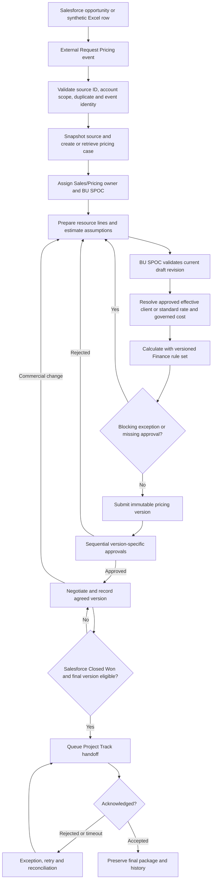
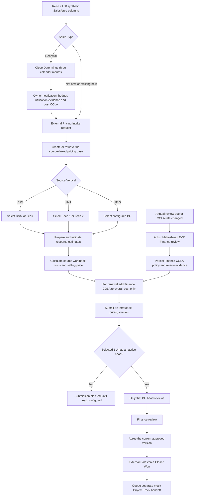

# Price Track process flow and release gates

This file describes the requested target flow and the current local implementation. It is a product flow, not evidence of Finance approval or production deployment. The handoff is background context; the user's newer direction takes precedence: opportunity creation and Request Pricing originate in Salesforce. The supplied synthetic Excel workbook is the temporary external opportunity source.

## System boundaries

| System | Owns | Price Track action |
| --- | --- | --- |
| Salesforce | Opportunity, account, lifecycle, Request Pricing trigger | Receive an identified, idempotent request and keep a source snapshot |
| Synthetic Excel source (temporary) | Sample opportunity rows | Let an authorized user select a source row and simulate the external trigger |
| Price Track | Pricing case, resources, rates, costs, calculations, versions, approvals, negotiation and exceptions | Never originate an opportunity; link one case to one source opportunity ID |
| Project Track | Delivery project | Receive the approved commercial package only after eligible Closed Won; acknowledge separately |

The UI no longer exposes a case-creation action; the synthetic Salesforce opportunity page is read-only and untriggered rows show **Awaiting external trigger**. Manual case creation is blocked. Normal startup uses session authentication and does not trust identity headers or user query parameters. The test-only legacy fixture adapter is enabled only by explicit test environment settings.

## Approved and implemented temporary external trigger

Use a separate **Pricing Intake** worksheet beside the supplied Salesforce synthetic workbook. A row references an existing `Opportunity ID`; it does not author opportunity fields. The requester sets `Request Pricing` to `Yes` and supplies a unique `Request ID`. An external local command such as `npm run intake -- --file <workbook> --request-id <id>` validates the row, reads the full source opportunity from the synthetic workbook, and posts an authenticated, idempotent event to the local Price Track intake API. Price Track returns the existing case for a replayed Request ID or Opportunity ID. The app itself has no create button. Keep this command as a mock adapter until a Salesforce webhook/API contract exists.

The user approved this design. The worksheet/CLI and token-authenticated API are implemented. `data/Pricing Intake.xlsx` contains all 1,057 source opportunities and all 38 source columns as references, with existing request selections preserved. The integration suite executes the real XLSX CLI path. See `LOCAL_PRODUCT_GUIDE.md` for commands.

## Implemented temporary identity and assignment

The `Opportunity Owner` value is the Client Partner login ID. Source-owned Opportunity IDs determine visible rows/cases; another owner sharing the account name does not gain access. Owner/account mappings and staff permissions persist in the database. Random temporary passwords are exported locally on first setup and stored as scrypt hashes. The user-controlled demo selector has been removed. SSO is still pending.

Requested Tech COE assignment seed (editable after setup):

| Capability / Tech COE | Named contact |
| --- | --- |
| BI COE | Tilak Mukherjee |
| AppDev Tech COE | Udayanath |
| AI Tech COE | Soviek Saurav |
| Databricks Tech COE | Amit Yadav |
| Data Engineering | Vikas Yadav |

Route estimate/pricing review by the Salesforce opportunity's Primary Capability to the matching Tech COE. Keep the role-to-contact mapping in the database and audit edits; do not treat the seed names as immutable code rules.

## Shared lifecycle

Draft saves advance the draft revision only. Submission creates an immutable version with input, rate, cost, FX and rule references. Approval applies to that version. Editing during approval stays in the working draft. A changed offer needs a new submission and approval before agreement or Closed Won.

## Three opportunity paths

| Path | Source evidence | Additional checks | Outcome |
| --- | --- | --- | --- |
| Net new | New Salesforce opportunity and account | Account/BU routing, initial SOW, currency, resources, client versus standard rate eligibility | New pricing case and first version |
| Existing customer, new work | New opportunity ID linked to an existing account | Existing contractual rate card scope, changed work type or region, account authorization; do not reuse a prior case ID | Separate pricing case, with references to applicable agreement/rates |
| Renewal | Renewal opportunity with prior agreement/SOW and dates | Prior versus proposed scope, utilization, staffing, term, rates, COLA and exceptions; in-app review begins three calendar months before Salesforce Close Date; overall renewal cost rises by the Finance COLA policy (initial 5%) | New renewal case and explicit change summary |

All three paths converge at resource validation, calculation, submission, approval and agreement. A missing SOW, cost, rate, FX or Finance policy produces a visible blocking exception; it does not silently become zero.

## Resource estimate workspace

1. Show source opportunity context, case owner, lifecycle and draft revision at the top.
2. Group line inputs as **Assignment** (BU, work type, role/skill, grade, location, classification), **Capacity** (quantity, dates, periods, hours, utilization), and **Commercial inputs** (currency, approved rate source, governed cost). Keep cost fields absent from Client Partner responses.
3. Show a compact line summary when collapsed: role, work type, quantity, period, validation status, resolved rate and blocking issues. Open one line at a time on small screens.
4. Save the draft with revision conflict protection. Invalidate BU validation when assumptions change.
5. Calculate from the saved draft, display unresolved inputs beside the affected line, then validate and submit. Keep **Save draft**, **Calculate**, **Validate**, and **Submit version** visibly separate.

## Finance formula contract

`data/Margin Calculator_new 1.xlsx` is unchanged. Source-linked cases use `src/workbook-pricing.js`: fixed role/experience costs, billability-inclusive resource cost, target-CM gross-up, employee bench loading and normalized vertical GM. All 1,781 formulas are extracted in `WORKBOOK_ALL_FORMULAS.csv` and `WORKBOOK_FORMULA_MANIFEST.json`. Cached examples pass comparison tests; fresh Excel recalculation and Finance acceptance remain required. Historical legacy calculations retain their original rule sets. Renewal COLA is a separately versioned user instruction: increase overall cost by the Finance percentage (initial 5%), with no automatic selling-price rise. Source rates are unchanged.

The supplied Master File - Rate Card is keyed by category, role/experience, and onshore/offshore, and includes cost/rate values. It does not contain employee names or unique employee prices. The current evidence therefore supports a **role/experience/location rate card**, not a fixed rate per named employee. If “fixed for every employee” means each individual has a unique rate, a separate approved employee-rate source is needed. Workbook cached results are not recalculated outputs, and Finance approval is still required before production use.

Finance rule records should carry effective dates, author, approver, workbook hash, formula IDs and approval status. Authorized person/role, routing and threshold changes must be persisted, audited and applied to future tasks/calculations; submitted versions retain prior snapshots. Self-approval and direct API bypass remain prohibited. Existing demo configuration and users persist in the local database state, but enterprise identity, governed cost/rule editing and SQL Server transactions are outstanding.

## Deployment gates

Local demo acceptance requires a source Excel row to create one case idempotently, all three paths to pass through the common lifecycle, persisted restart, account/cost access tests, revision conflict, approval and mock handoff tests. Production release additionally requires full workbook golden parity and Finance sign-off, approved Program/Product rules, trusted authentication, SQL Server provider and migration tests, external contracts, security review, backup/restore evidence, CI and monitoring. The current POC does not meet those gates.

## Renewal alerts and named BU approval flow

See [the complete source-field map](SALESFORCE_FIELD_MAP.md) for populated counts, absent fields and annual COLA review.

Named heads: R&M — namratta pandya; CPG — Ashish gupta; Tech 1 — Anil damodaran; Tech 2 — kiran nandavarappu; MMM — mallesh reddy. HLS-A, HLS-CI and RAI remain unassigned. BU-head mappings are editable in Administration, persisted and audited. A source parent vertical does not guess which child BU applies.

Renewal notifications can exist before any pricing case; they never create cases. Actual utilization requires an entered percentage and evidence, while proposed billability is derived from estimates. Finance policy changes revise active renewal drafts and require validation again. Submitted pricing calculations and approval assignees remain historical snapshots.
