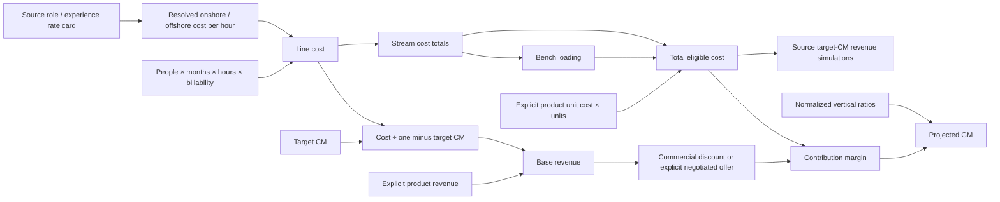

# Financial dependency flow

The full formula register preserves exact worksheet names, including trailing whitespace. Shared source formulas are expanded without changing the source workbook. Application line aggregation generalizes the workbook's resource rows; it is not a generic Excel execution engine. Discount and negotiated offer are explicit commercial scenario inputs. Unsupported source/Finance decisions remain blocking or visibly unavailable.
